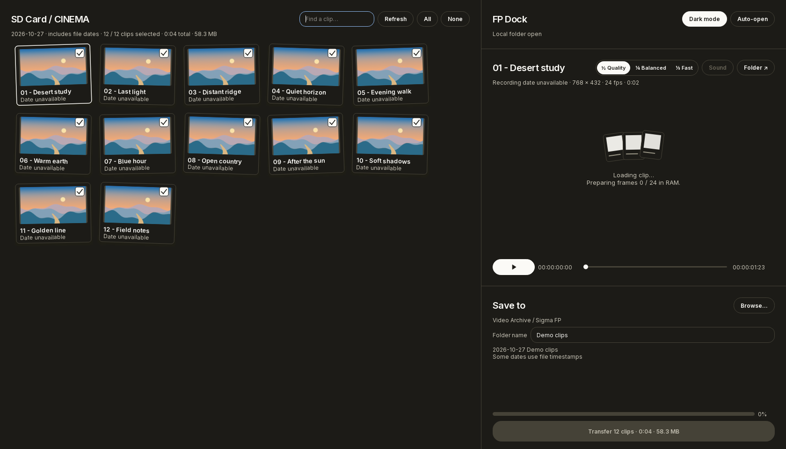

# FP Dock

**Browse Sigma fp CinemaDNG clips, preview them, and copy selected takes to another drive with checksum verification.**

[Downloads](https://github.com/EliasAndreArchive/FP-Dock/releases) · [Build status](https://github.com/EliasAndreArchive/FP-Dock/actions/workflows/build.yml) · [Color pipeline](docs/COLOR.md) · [Build from source](#run-or-build-from-source)



FP Dock treats a folder of DNG frames as one video clip. It was made for the Sigma fp's `CINEMA` folder, including losslessly compressed CinemaDNG. The interface keeps your clip browser, player, and transfer controls together.

**Your RAW files stay unchanged.** Color, exposure, shadow lift, playback quality, thumbnails, and dark mode affect the preview only. Transfers copy original file bytes and verify the destination by reading it back.

## Download and open

Open [Releases](https://github.com/EliasAndreArchive/FP-Dock/releases) and choose the package for your computer:

| Computer | Package | Launch |
| --- | --- | --- |
| Windows 64-bit | `FP-Dock-Windows-x64.zip` | Extract the entire folder, then open `FPDock.exe`. Keep `_internal` beside it. |
| Linux 64-bit | `FP-Dock-Linux-x64.tar.gz` | Extract it, then run `./FPDock` inside the extracted folder. A graphical desktop is required. |
| Mac with Apple silicon | `FP-Dock-macOS-arm64.zip` | Extract it and move `FPDock.app` to Applications before enabling Auto-open. |
| Mac with an Intel processor | `FP-Dock-macOS-x64.zip` | Use the Intel package and move `FPDock.app` to Applications. |

These are early builds. Windows camera playback has been tested on an AMD Radeon RX 7800 XT. Linux and macOS packages are built and checked on their own operating systems in GitHub Actions; that does not replace testing your camera, GPU, or desktop environment. See [platform support](docs/PLATFORMS.md).

The downloads are not Windows Authenticode-signed or Apple Developer ID-notarized. macOS may ask you to approve opening the application through its security settings. Every downloadable archive has a `.sha256` checksum beside it.

## Connect, browse, and play

1. Connect the fp in **USB storage mode**, or insert the SD card in a reader.
2. FP Dock looks for a folder named **`CINEMA`**. You can also use **Open…**, `Ctrl+O`, or drag a folder into the window.
3. Wait for thumbnails to finish loading. Cards appear when their thumbnails are ready.
4. Click a thumbnail to preview the clip on the right. Its recording date, time, resolution, frame rate, and length appear above the video when available.
5. Press **Space** or click Play to pause/resume. Drag the timeline to seek. Use **Sound** to toggle available audio and **Folder ↗** to open the clip's original folder.

The top-left summary shows the selected clip count, their combined duration, and their total transfer size. A duration containing `+ unknown` means a selected non-DNG video does not have duration metadata available to this summary; FP Dock does not invent its length. Missing recording metadata is labelled instead of presented as a camera-recorded date.

### Playback quality

The quality bar changes the preview resolution, not the RAW files:

| Setting | Purpose |
| --- | --- |
| **½ Quality** | More preview detail; more processing work. |
| **¼ Balanced** | A smaller preview for a practical speed/detail balance. |
| **⅛ Fast** | Lowest preview resolution for demanding clips or slower hardware. |

The renderer applies these reductions and a preview-size limit. Lossless DNG decompression still runs on the CPU, so lower quality cannot eliminate the cost of reading and decompressing the original frames.

When supported, OpenGL handles Bayer rendering and color processing on the GPU. FP Dock prepares a bounded rolling queue in RAM before playback; it does **not** generate full-clip proxy files or a disk playback cache. If storage or decoding falls behind, the player may buffer. Real-time playback depends on resolution, compression, storage speed, CPU, and GPU; it is not guaranteed on every system.

## Select and transfer clips

1. Use clip checkboxes to choose what to copy. **All** and **None** change the whole selection. Clicking a checkbox on a highlighted group applies the change to that group.
2. Under **Save to**, choose a destination on another drive or SSD.
3. Optionally enter a name in **Name your folder**.
4. Check the generated folder name and the Transfer button's clip count, combined clip length, and size.
5. Click **Transfer**. The progress bar reports copying and verification. **Cancel** stops safely; it does not delete originals.
6. Wait for **Transfer verified**. The button then opens the verified copy.

The transfer includes selected DNG sequences, associated audio, and applicable supporting files. Unselected sequences are left out. The size therefore includes more than just the DNG frame bytes.

### Folder naming

FP Dock uses the earliest and latest recording dates among the **selected** clips:

```text
2026-09-26 Forest/
2026-09-27 - 2026-09-29 Street clips/
```

Dates come from clip metadata, including the sequence endpoints. File timestamps are a labelled fallback when recording dates are unavailable. The optional name goes after the date or date range.

Inside the session folder, the original clip structure is preserved. Verification and resume information lives in a separate folder:

```text
2026-09-26 Forest/
├── A001_001/                 # Original clip folder and files
├── A001_002/
├── other applicable files
└── Extras/                   # Verification / resume metadata
    ├── transfer.json
    ├── checksums.sha256
    ├── transfer.lock
    └── Partials/             # Temporary data for interrupted copies
```

If the source already uses `Extras`, the verification folder receives a non-conflicting name. Different transfers with the same date/name receive a numbered folder rather than overwriting an unrelated session.

### What verification means

FP Dock hashes source data with **SHA-256**, writes the copy, and independently reads and hashes the destination. A session is verified only after its selected files pass these checks. Matching interrupted sessions can resume, with existing copied files checked again.

The app checks for source changes, refuses unsafe destination paths, and prevents concurrent writes to the same session. It will not delete footage from your camera, format a card, or overwrite a different transfer. Verification confirms that this copy matches its source; it is not a replacement for keeping another backup or periodically checking storage health.

## How the preview colors work

The preview is deliberately easier to judge than an untouched dark RAW decode. It is **not a baked-in grade** and does not change what Resolve reads from your DNGs.

```text
Original RAW frame
  → RAW decoding, black-level correction, camera white balance / color calibration
  → Highlight reduction in scene-linear light
  → DaVinci Wide Gamut / DaVinci Intermediate
  → Bundled 65-point Resolve output LUT
  → Display exposure adjustment + shadow lift + gamut protection
  → Rec.709 Gamma 2.4 preview image
```

- **The LUT is bundled.** It was exported from Resolve for DWG/Intermediate → Rec.709 Gamma 2.4, with DaVinci tone mapping, saturation compression, and Forward OOTF baked into that output transform. There is no LUT picker to configure.
- **Highlights are reduced before the LUT.** This is a fixed scene-linear shoulder, not an exact implementation of another editor's “Highlights −100” slider.
- **Auto exposure is preview ETTR.** After the LUT, FP Dock searches for the brightest useful preview exposure with headroom near display white. It meters the 99.5th percentile of maximum RGB values, so tiny bright reflections do not darken the whole scene. It is not a camera-exposure or RAW metadata change.
- **Shadows are lifted separately.** Deep shadows receive up to roughly two stops of lift, fading out toward the highlights. This can reveal noise already present in the capture.
- **Exposure is held per clip.** It is metered from the initial frame rather than adjusted every frame, avoiding brightness pumping. Lighting changes later in a take are not re-metered automatically.
- **RAW precision is preserved through processing.** Original 12-bit samples are processed using floating point; the final on-screen image is currently 8-bit. The saved DNGs retain their original precision.

This does not reproduce Resolve's entire proprietary camera-RAW pipeline or its Blackmagic Film camera-RAW setting. A matching output LUT alone does not guarantee an exact match to a Resolve grade. See [the detailed color notes](docs/COLOR.md) for the math, scope, and limitations.

Dark mode changes only the interface. It uses the same existing dark `#1c1b17` and off-white `#fbfaf6` palette in reverse; it does not change the video transform.

## Auto-open and background operation

**Auto-open** keeps FP Dock watching for newly connected media with a `CINEMA` folder. On a packaged first launch, the app attempts to enable this and register per-user login startup. You can turn it off with the Auto-open toggle.

- Existing mounted drives form the initial baseline, so they do not repeatedly open the window.
- Late-appearing `CINEMA` folders are detected after mounting finishes.
- With Auto-open enabled, closing the window hides it to the tray/menu-bar icon when that facility is available. Use the tray menu to quit fully.
- Disconnecting the camera clears stale clips and stops an active transfer safely. Verified copies remain available for resume.
- Source builds can watch while running, but automatic login startup is intended for the packaged application.

Windows uses device notifications plus polling. Linux and macOS use mounted-volume polling. Desktop tray support and Linux mount locations matter; details and login-startup file locations are in [platform support](docs/PLATFORMS.md).

## Run or build from source

Use **Python 3.12** and a separate environment:

```sh
git clone https://github.com/EliasAndreArchive/FP-Dock.git
cd FP-Dock
python -m venv .venv
```

Activate it with `.venv\Scripts\activate` on Windows or `source .venv/bin/activate` on Linux/macOS, then:

```sh
python -m pip install -r requirements-build.txt
python scripts/make_demo.py
python source/ingest.py Demo/CINEMA
```

The demo generator creates synthetic Bayer DNGs, not downloaded footage or private camera recordings. `Demo/` is generated locally and excluded from Git.

Run tests and create a native package:

```sh
python -m unittest discover -s source/tests -v
python scripts/build.py
python scripts/check_bundle.py
```

Packages and SHA-256 checksums are written to `artifacts/`. Build on the target operating system: PyInstaller is not a cross-compiler. The [GitHub Actions workflow](.github/workflows/build.yml) builds Windows, Linux, Apple-silicon macOS, and Intel macOS independently, tests the packaged executables, and publishes prerelease downloads only when all four builds pass.

## Troubleshooting

| Problem | Try this |
| --- | --- |
| Camera does not appear | Use USB storage mode, wait for the OS to mount it, and check for `CINEMA`. Try **Open…** or **Refresh**. |
| Playback buffers | Try Balanced or Fast, use a faster card reader/SSD, and update the GPU driver. Lower preview resolution still requires RAW decompression. |
| Preview differs from Resolve | Check the output-transform settings and remember that the RAW decode, highlight shoulder, ETTR, and shadow lift are separate preview adjustments. |
| Transfer is unavailable | Select clips and choose a writable destination on another volume. A folder on the same volume is rejected. |
| Background icon is missing on Linux | Your desktop may need a tray extension. Keep the window open or launch it manually. |
| Windows Qt/DLL startup error | Extract a fresh complete package. Do not copy just the executable or mix `_internal` files from different builds. |

Settings and `ingest.log` live in Qt's per-user application-data folder. The internal organization/application names remain `VisualFieldNotes` / `Ingest` for compatibility with existing installs. No accounts, analytics, or cloud upload are required for the app to browse, preview, or transfer footage.

## License and acknowledgements

Application code is [MIT licensed](LICENSE). Qt/PySide6, LibRaw/rawpy, imagecodecs, NumPy, tifffile, Inter, and other bundled components retain their own licenses; see [third-party notices](THIRD-PARTY-NOTICES.md). The bundled Resolve LUT is a supplied project asset, separate from the library implementations.

FP Dock is an independent project by [EliasAndreArchive](https://github.com/EliasAndreArchive), with a visual style inspired by [eliasandre.space](https://eliasandre.space). It is not affiliated with Sigma or Blackmagic Design.
